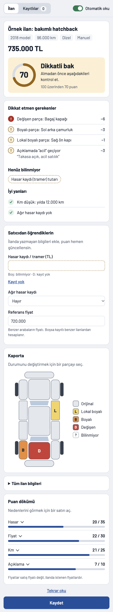
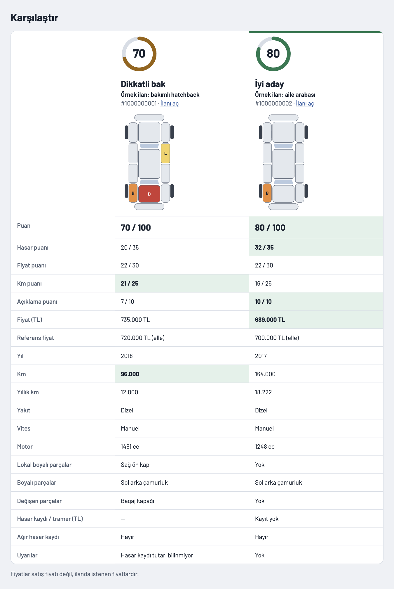

# Used Car Scorer

[](https://github.com/keremeersoy/used-car-scorer/actions/workflows/ci.yml)
[](https://github.com/keremeersoy/used-car-scorer/actions/workflows/codeql.yml)

A personal Chrome extension for comparing used car listings on sahibinden.com. Open a listing,
click the extension icon, and a side panel reads it and shows a score out of 100 with the reasons.
Save listings and compare them side by side. The interface is in Turkish.

> **Terms of service risk:** the site may detect extensions or consider them against its terms and
> restrict your account. Read the terms before using this. This project is not affiliated with
> sahibinden.com.

<p>
  
</p>



## Features

- Reads the open listing in one click; every field can be corrected by hand.
- The score updates as you type, and every section explains itself.
- A missing value is never treated as clean.
- Compare, delete, back up and restore saved listings.
- All data stays in the browser. No server, no analytics.

## What it does not do

It does not crawl, open pages on its own, fetch by listing number, get around bot protection or add
anything to the page. It reads only the page that is already open, only when you click.

Permissions: `activeTab`, `scripting`, `storage`, `sidePanel`. No site access is requested, and the
content security policy blocks all network requests from the extension.

## Install

Requires Node 24 (see `.nvmrc`) and Chrome 116 or later.

```bash
npm ci
npm run build
```

Open `chrome://extensions`, turn on **Developer mode**, choose **Load unpacked** and select `dist/`.
Reload the extension after each build.

The extension id is fixed (`lnlcddeibdpccfdocfclbpclhacleoph`, derived from the public key in the
manifest), so moving the folder keeps your saved listings. Removing the extension deletes them:
back them up first with **Yedek al** on the **Kayıtlılar** tab and restore with **Yedekten yükle**.

**Upgrading from a version without the fixed id:** before building the new version and reloading,
click **Yedek al**. The id changes once, so old data is no longer visible and Chrome may delete it.
Restore the file in the new version.

## Use

1. On a listing's detail page, click the extension icon.
2. Correct fields if needed, for example the damage record amount, which the page has no field for.
3. Click **Kaydet** (save).
4. On the **Kayıtlılar** (saved) tab, select two or more listings and click **Karşılaştır** (compare).

**Tekrar oku** (read again) reads another listing opened in the same tab. A new tab needs the icon
again.

## Scoring

| Section | Weight | Based on |
|---|---|---|
| Damage | 35 | Painted and replaced parts, damage record amount, heavy damage record |
| Price | 30 | A reference price you enter, otherwise the median of at least 5 similar saved listings |
| Km | 25 | Average kilometres per year |
| Description | 10 | Warning phrases, with Turkish negation handling |

Without a reference, price is left out and the rest is rescaled to 100. Prices are asking prices,
not sale prices. All numbers and word lists are in
[`src/scoring/config.ts`](src/scoring/config.ts). Details are in the
[design document](docs/superpowers/specs/2026-11-27-used-car-scorer-design.md).

## Development

```bash
npm run check     # lint, tests, type check, build and dependency audit
npm run format    # apply Biome formatting and safe fixes
```

Git hooks (Husky) lint staged files, check commit messages against
[Conventional Commits](https://www.conventionalcommits.org/) and run lint, type check and tests
before a push. On GitHub, CI and CodeQL run on every pull request, and Dependabot proposes updates
weekly.

| Folder | Contents |
|---|---|
| `src/extract` | Reading a listing page |
| `src/scoring` | Scoring and its configuration |
| `src/draft`, `src/storage` | Editing, saving and backups |
| `src/read` | From the click to a copy of the page |
| `src/ui` | Side panel and compare view (all Turkish copy is in `strings.ts`) |

### Reader tests

Selectors come from listing pages saved by hand into `fixtures/`, which is **never committed**, each
with a `<name>.expected.json` beside it. When the folder is empty, as in CI, the page tests are
skipped and the reader counts as unverified.

Remove seller names, phone numbers and your own account details from saved pages. When the site
changes, save a new page, write its expected values and fix `src/extract/`. Never fetch pages from
the site automatically.

## Status

A working first version. Known issues are tracked in
[Issues](https://github.com/keremeersoy/used-car-scorer/issues).
